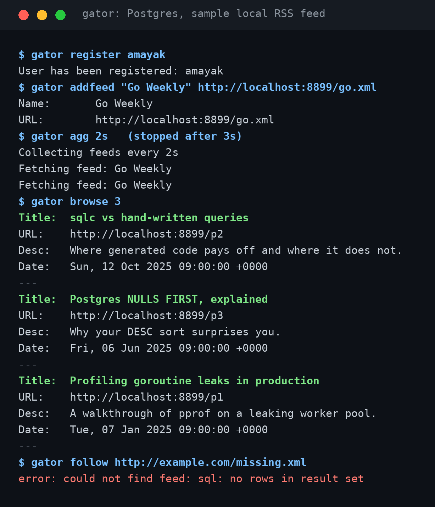

# Gator

**A command-line RSS reader backed by Postgres: register users, add feeds, let a background loop collect posts, and browse the newest ones from the feeds you follow.**
 

*A real run against a local Postgres and a sample RSS file served from localhost.*
 
## Motivation
 
Reading blogs through a browser means checking each site by hand. Gator turns that into one command: follow the feeds you care about, keep `gator agg` running, and `gator browse` shows what is new.
 
It is also a compact full-stack Go service: a typed query layer generated by [sqlc](https://sqlc.dev/), schema migrations with [goose](https://github.com/pressly/goose), a polling worker that always fetches the feed it has gone longest without, and per-user follow state.
 
## Quick Start
 
Requires [Go](https://go.dev/dl/) 1.21+ (`go.mod` pins 1.26.4; newer Go downloads that toolchain automatically) and a running [PostgreSQL](https://www.postgresql.org/download/) server.
 
**1. Build the binary.** `go install` names it after the module (`blog-aggregator`), so build it as `gator`:
 
```bash
git clone https://github.com/amayakmt/blog-aggregator.git
cd blog-aggregator
go build -o gator .
```
 
**2. Create the database and run the migrations:**
 
```bash
createdb gator
go install github.com/pressly/goose/v3/cmd/goose@latest
goose -dir sql/schema postgres "postgres://USER:@localhost:5432/gator?sslmode=disable" up
```
 
**3. Create `~/.gatorconfig.json`.** Gator does not create it for you and exits with a file-not-found error without it:
 
```json
{
  "db_url": "postgres://USER:@localhost:5432/gator?sslmode=disable",
  "current_user_name": ""
}
```
 
**4. Run it:**
 
```bash
./gator register alice
./gator addfeed "Hacker News" "https://news.ycombinator.com/rss"
./gator agg 1m        # leave this running in its own terminal
./gator browse 5
```
 
## Usage
 
### Commands
 
| Command | What it does |
| --- | --- |
| `register <name>` | Creates a user and switches to it |
| `login <name>` | Switches to an existing user |
| `users` | Lists users and marks the current one |
| `addfeed <name> <url>` | Adds a feed and follows it (login required) |
| `feeds` | Lists every feed and who added it |
| `follow <url>` | Follows a feed someone already added (login required) |
| `unfollow <url>` | Stops following a feed (login required) |
| `following` | Lists the feeds you follow (login required) |
| `agg <interval>` | Runs the collector forever, for example `30s` or `5m` |
| `browse [limit]` | Shows your newest posts, 2 by default (login required) |
| `reset` | Deletes every user and, through cascades, all feeds, follows, and posts |
 
### How collection works
 
Each tick of `agg` picks the single feed that was fetched longest ago (never-fetched feeds first), marks it fetched, downloads it, and stores each item as a post. Posts are unique by URL, so re-fetching a feed adds only new items. Run `agg` with an interval that matches how many feeds you follow: with 10 feeds and a 1 minute interval, each feed refreshes every 10 minutes.
 
`browse` orders posts by their published date, newest first, and puts posts with no date last.
 
### Limits
 
- RSS 2.0 only. Atom feeds are not parsed.
- The fetcher does not check HTTP status codes, so an error page is parsed as an empty feed.
- `users.name` has no unique constraint. Uniqueness is enforced by a lookup before insert, so two simultaneous `register` calls could create duplicates.
- `reset` has no confirmation prompt.
## Contributing
 
### Clone and build
 
```bash
git clone https://github.com/amayakmt/blog-aggregator.git
cd blog-aggregator
go build ./...
go vet ./...
```
 
The repository has no automated tests yet. Before opening a pull request, run the flow in Quick Start against a scratch database, including `follow` with an unknown URL.
 
### Change the schema or queries
 
Add a new numbered file in `sql/schema/` for schema changes, edit queries in `sql/queries/`, then regenerate the Go code:
 
```bash
sqlc generate
```
 
### Project layout
 
```text
main.go                 # Wiring: config, DB connection, command registry
commands.go             # Command registry and login middleware
handler_users.go        # register, login, users, reset
handler_feed.go         # addfeed, feeds, follow, unfollow, following, agg, browse
rss.go                  # Feed download and parsing
internal/config/        # ~/.gatorconfig.json read and write
internal/database/      # sqlc-generated query code
sql/schema/             # goose migrations
sql/queries/            # sqlc query definitions
```
 
### Submit a pull request
 
Fork the repository and open a pull request to `main` with a focused change.
 
## License
 
[MIT](LICENSE)